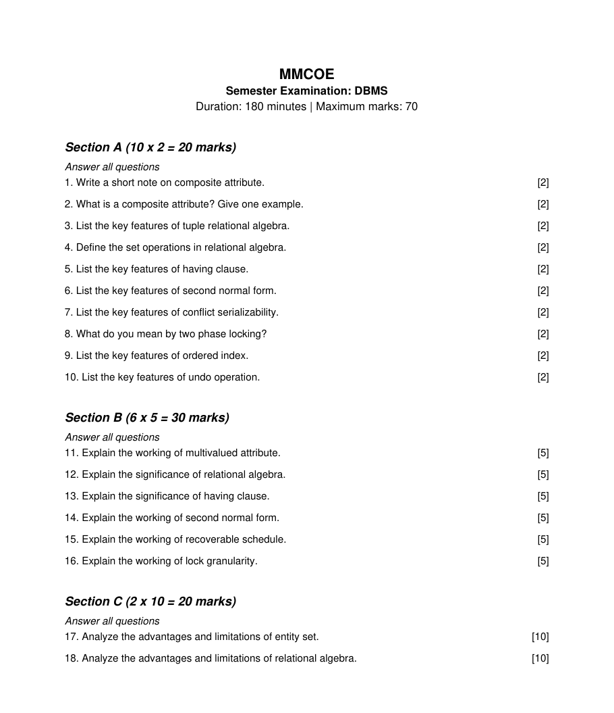
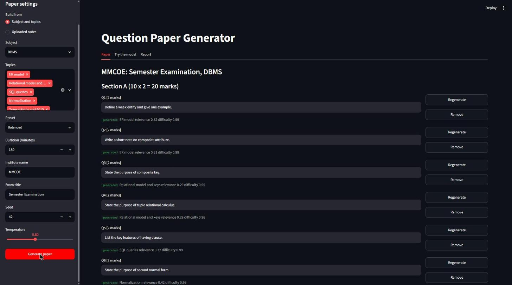

# LSTM Question Paper Generator

Generates exam papers for four CSE subjects (DBMS, Operating Systems, Computer Networks, Data Structures and Algorithms). A word-level LSTM trained on a bank of about 3,400 labelled questions writes new questions for a chosen subject, topic and difficulty. Filters drop weak or copied questions, and a paper builder lays out a 70 mark paper with sections and marks, exported as DOCX, PDF and JSON. You can also upload notes (PDF, TXT or MD) or type a chapter name, and the paper is built for the topics the notes cover.



## How it works

1. **Data.** Hand-written seed questions plus template expansion over concept lists give 3,445 questions, labelled by subject, topic (8 per subject) and difficulty (easy 2 marks, medium 5, hard 10).
2. **Model.** A 2-layer LSTM (256 units, tied embeddings, about 1.3M parameters) learns to continue a sequence that starts with control tokens, for example `<bos> <subj_dbms> <topic_normalization> <diff_medium>`.
3. **Sampling.** Temperature 0.8 and top-k 40, with special tokens blocked and repeated trigrams banned.
4. **Filters.** Format, cleanliness, ending word, novelty (not a copy of a training question), near duplicates, topic relevance (TF-IDF cosine to the topic centroid), difficulty (TF-IDF logistic regression) and a phrase check (every word pair must appear in a real question). If too few survive, it samples again, relaxes thresholds, then fills from the real bank.
5. **Paper.** Questions are spread over the chosen topics by weight and checked for total marks and repeats.

Settings for all of this live in `config/default.yaml`.

## Setup

Python 3.10 or newer.

```bash
python -m venv .venv
source .venv/bin/activate          # Windows: .venv\Scripts\activate
pip install -r requirements.txt
pip install -e .
```

For an NVIDIA GPU, swap in the CUDA build of torch after the install above (pick the CUDA version your driver supports):

```bash
pip install --force-reinstall --no-deps torch==2.14.1 --index-url https://download.pytorch.org/whl/cu130
```

A CPU is enough. Training takes about 4 minutes on a laptop CPU and under a minute on a GPU.

## Commands

| Make target | Command it runs | What it does |
| --- | --- | --- |
| `make data` | `python -m qpgen.data.build_dataset` | Builds `data/processed/` from the seed files and templates |
| `make train` | `python -m qpgen.train` then `python -m qpgen.classifiers` | Trains the LSTM and the TF-IDF classifiers |
| `make eval` | `python -m qpgen.evaluate` | Writes every metric and plot to `reports/` |
| `make app` | `streamlit run app/streamlit_app.py` | Opens the app |
| `make test` | `python -m pytest -q` | Runs the tests |

On Windows, `make` is not installed by default. Either run the commands directly or install it with `winget install ezwinports.make`.

Generate questions or a paper from the command line:

```bash
python -m qpgen.cli generate --subject DBMS --topic Normalization --difficulty medium -n 5 --seed 42
python -m qpgen.cli paper --subject DBMS --topics "Normalization,SQL queries" --preset balanced --seed 42 --format docx
python -m qpgen.cli paper --from-file notes.pdf --preset balanced
```

Papers go to `outputs/`. Presets are `balanced` (10 x 2, 6 x 5, 2 x 10), `easy_heavy` and `hard_heavy`, all 70 marks.

## App

The sidebar takes a subject and topics, or uploaded notes, plus preset, duration, institute, exam title, seed and temperature. The Paper tab lets you regenerate, edit or remove any question before downloading. The other tabs show raw samples with the reason each rejected one failed, and the evaluation report.



## Results

All numbers come from `reports/metrics.md` (20 raw candidates for each of the 96 subject, topic and difficulty cells, seeds 42, 43 and 44, mean over seeds).

| | LSTM | Trigram baseline | Real test questions |
| --- | --- | --- | --- |
| Validation perplexity | 3.84 | 10.17 | |
| Test perplexity | 4.05 | 9.34 | |
| Raw novelty (not a training copy) | 0.38 | 0.61 | |
| Filter pass rate | 12% | 25% | |
| Topic accuracy, filtered | 0.90 | 0.97 | 0.85 |
| Difficulty accuracy, filtered | 1.00 | 0.99 | 0.99 |
| Distinct-2, filtered | 0.39 | 0.36 | 0.51 |
| Self-BLEU, filtered (lower is more varied) | 0.57 | 0.57 | 0.45 |

The LSTM fits real questions far better than the trigram model, and after filtering it uses a wider range of word pairs (distinct-2) at about the same self-BLEU. The trigram baseline wins on novelty, pass rate and topic accuracy. Most of the LSTM's raw output repeats training questions, and dropout 0.4 or a smaller hidden size did not fix that (see the ablations in `reports/metrics.md`). Training without control tokens drops topic accuracy to 0.03, so the conditioning does work. Difficulty accuracy is close to 1 because the labels follow the opening verb, so it says more about the data than the model.

Training on an RTX 4050 took 44 s and on a laptop CPU 261 s (`reports/training_log.csv`, `reports/training_log_cpu.csv`).

Human ratings are collected with `reports/human_rating_sheet.csv` (60 shuffled questions, 20 each from the LSTM, the trigram model and the real bank). Average filled-in copies with `python -m qpgen.evaluate --ratings a.csv b.csv c.csv`.

## Project layout

```text
config/          settings, subjects and topics, concept lists, acronyms
data/raw/        seed question files (data/processed/ is built by make data)
src/qpgen/       tokenizer, dataset, model, training, sampling, filters, baseline, paper builder, export, upload, cli, evaluation
app/             Streamlit app
tests/           one test file per module
reports/         training logs, metrics, plots, samples, rating sheet
```

Your own syllabus or past paper questions can go in `data/raw/student_questions.csv` with the columns `subject,topic,difficulty,question` (subject spelled as above, for example `Operating Systems`). `make data` picks them up.

Progress and design decisions are in [PROGRESS.md](PROGRESS.md).
